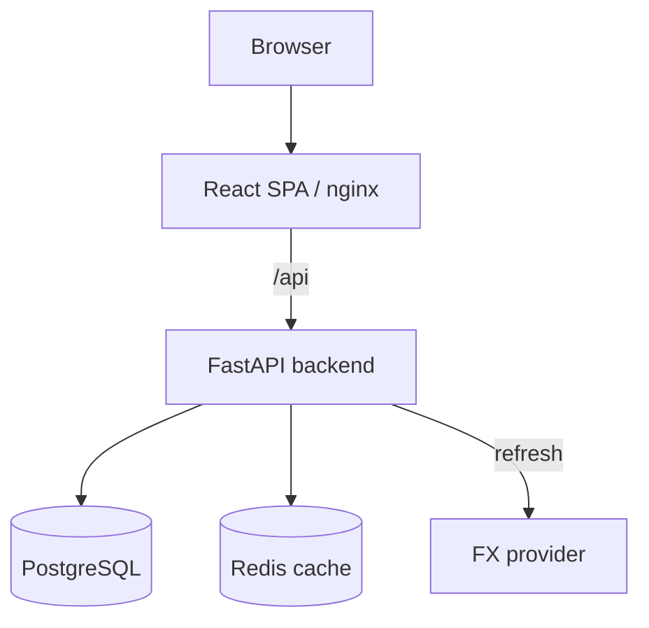
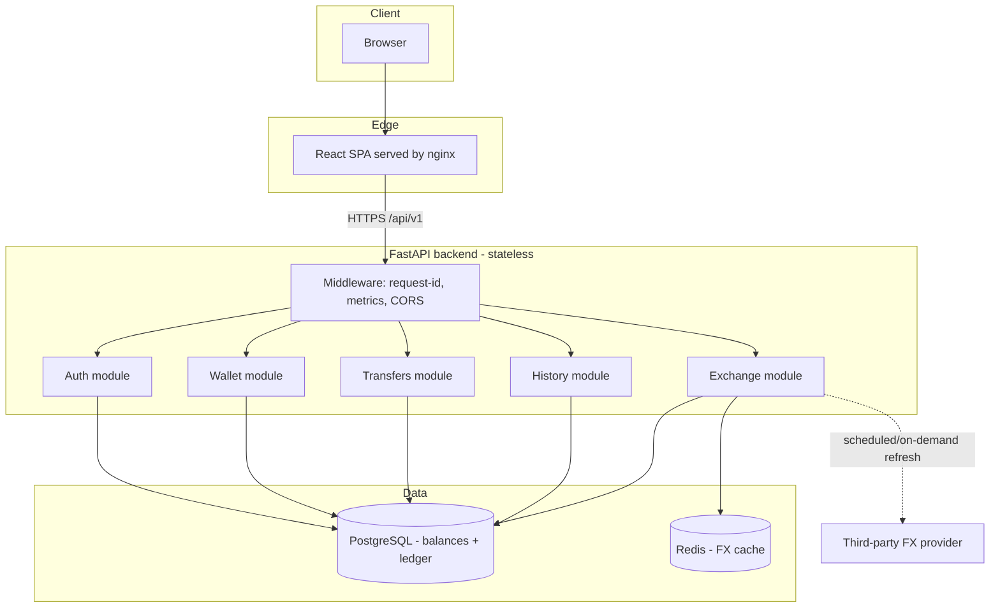
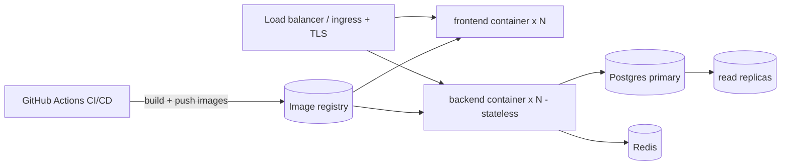
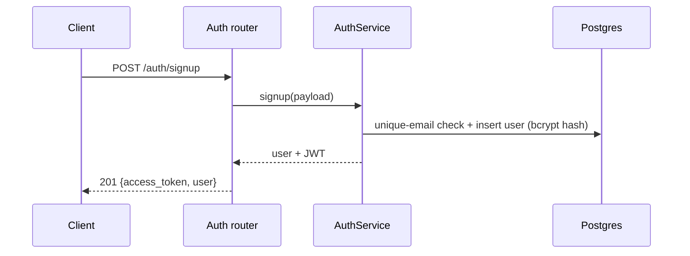
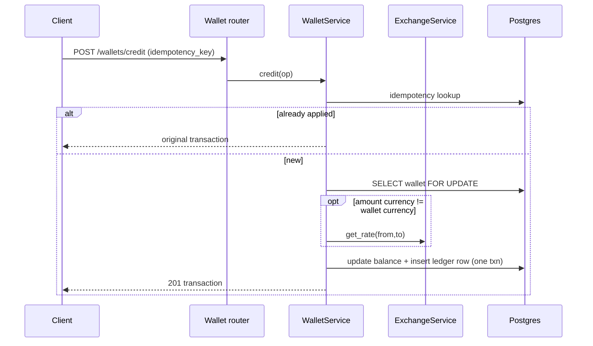
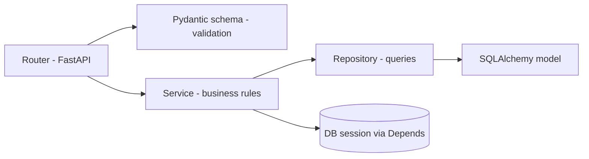
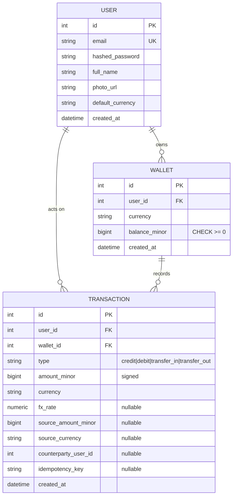
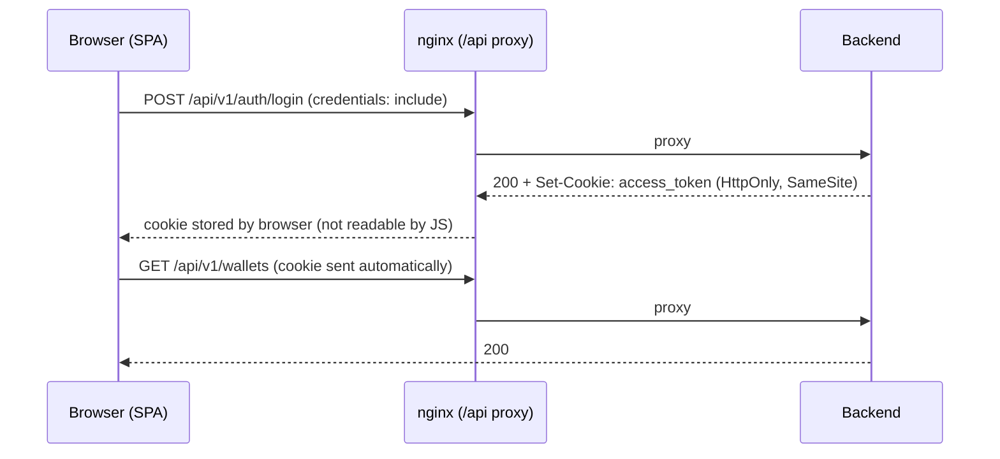

# Architecture

## Overview

A **modular monolith**: one FastAPI application internally partitioned into
independent domain modules, backed by one PostgreSQL database and a Redis cache.
The frontend is a separate React SPA served by nginx, which proxies `/api` to the
backend.



### Why a modular monolith (not microservices)

The challenge proposed "separate microservices for frontend, backend, DB" — that
is a 3-tier deployment, not microservices. True microservices split the backend
by domain, each with its own DB. We deliberately chose **not** to:

- **Money correctness is the core risk.** A cross-currency transfer debits one
  wallet and credits another. In a monolith this is a single ACID transaction
  with row locks. Across services it requires sagas / outbox / distributed
  transactions — more code, more failure modes, real risk of lost or duplicated
  money.
- **Operational simplicity** fits the scope while still being production-minded.
- **Extensibility preserved:** modules talk through service interfaces and never
  reach into each other's tables, so a hot module (e.g. exchange) can be
  extracted into its own service later with minimal change.

## High-Level Design (HLD)

### Component view



### Deployment view



- **Stateless backend** → horizontal scale behind the load balancer. Session
  state lives entirely in the JWT; nothing sticky.
- **Single write primary** for the ledger (source of truth) with read replicas
  for history/reporting.
- **Redis** is a best-effort cache; the system degrades to the DB fallback if it
  is unavailable.

### Key request flows

Signup / login:



Credit / debit (with optional conversion) — see LLD for the locking detail:



## Module structure

```
app/
  core/        config, database, security (JWT/bcrypt), money, logging
  modules/
    auth/      users, signup/login, profile, JWT dependency
    wallet/    balances, credit/debit, ledger (Transaction), idempotency
    exchange/  FX rates: cache-first -> DB fallback -> provider
    transfers/ atomic cross-currency user-to-user transfer
    history/   filtering + pagination over the ledger
  main.py      app wiring, middleware, health/ready/metrics
```

Each module follows **router → service → repository → model** layering. Pydantic
schemas live at the API boundary (validation/serialization); SQLAlchemy models
own persistence. The two are kept separate on purpose.

## Domain & data model

- **User**: credentials, profile, default currency.
- **Wallet**: `(user_id, currency)` unique; `balance_minor` as **integer minor
  units** (cents/paise/yen) — never floats.
- **Transaction**: immutable ledger entry per balance change. Stores signed
  `amount_minor`, the `fx_rate` applied, source amount/currency, counterparty,
  and an `idempotency_key` (unique per user).

Every balance mutation writes exactly one ledger row, so balances are always
reconstructable and conversions are fully traceable.

## Low-Level Design (LLD)

### Layering per module



- **Router**: HTTP concerns only — parse, call service, map domain errors to
  status codes.
- **Service**: owns business invariants (balance checks, idempotency, locking,
  conversion). Transaction boundary lives here.
- **Repository**: all SQL; no business logic. Hosts the locked read.
- **Model / Schema**: persistence vs. API contract, kept separate.

### Data model (ER)



Constraints enforcing correctness at the DB layer:

- `UNIQUE(user_id, currency)` on `wallets` — one wallet per currency per user.
- `CHECK(balance_minor >= 0)` on `wallets` — no path can persist an overdraft.
- `UNIQUE(user_id, idempotency_key)` on `transactions` — retries can't double-apply.
- Index on `transactions(user_id, created_at)` — history filtering/pagination.

### Transfer — concurrency & locking (critical path)

```mermaid
sequenceDiagram
    participant C as Sender
    participant T as TransferService
    participant DB as Postgres (one txn)
    C->>T: POST /transfers (amount, from, to, idempotency_key)
    T->>DB: idempotency lookup -> if found, return original
    T->>T: resolve recipient; reject self-transfer
    T->>T: get FX rate; compute debit_minor + credit_minor
    T->>DB: ensure both wallets exist
    Note over T,DB: lock in stable order (by user id)
    T->>DB: SELECT sender wallet FOR UPDATE (populate_existing)
    T->>DB: SELECT recipient wallet FOR UPDATE (populate_existing)
    T->>T: assert sender.balance >= debit_minor
    T->>DB: debit sender, credit recipient
    T->>DB: insert transfer_out + transfer_in ledger rows
    T->>DB: COMMIT
    alt unique-key race (IntegrityError)
        T->>DB: ROLLBACK + return original
    end
```

**Why each step matters:**

- **`FOR UPDATE` with `populate_existing`** — locks the row *and* refreshes the
  in-memory balance under the lock, so concurrent writers serialize correctly
  (see Challenges & Fixes for the bug this prevents).
- **Stable lock order by `user_id`** — two users transferring to each other
  simultaneously can never deadlock.
- **Single transaction** — debit, credit, and both ledger rows commit atomically
  or not at all; partial transfers are impossible.
- **Idempotency key + unique constraint** — a retried transfer returns the
  original result instead of moving money twice; a lost race is caught at commit
  and resolved to the original.

### Money handling (LLD)

- Stored as integer **minor units** (`balance_minor`, `amount_minor`).
- `Decimal` used only when crossing major↔minor or applying FX; rounding is
  `ROUND_HALF_EVEN` (banker's rounding).
- Per-currency decimals table (`USD/EUR/GBP/INR=2`, `JPY=0`) drives conversion.
- Each conversion persists the exact `fx_rate` + source amount on the ledger row
  → full traceability and reproducibility.

## Money correctness

- **Integer minor units** in storage; `Decimal` for any major/minor or FX math;
  banker's rounding (`ROUND_HALF_EVEN`).
- **Idempotency keys** on credit/debit/transfer make retries safe — a replayed
  request returns the original result instead of applying twice.
- **Atomic transfers**: both wallets are row-locked (`SELECT ... FOR UPDATE`) in a
  stable order (by user id) to avoid deadlocks; debit, credit, and both ledger
  rows commit in one transaction.

## Exchange provider resilience

Rate resolution order at request time: **Redis cache → DB last-known → error**.
The provider is *never* called synchronously on the transaction path; a refresh
job (startup + on-demand `/exchange/refresh`, a cron/worker in prod) populates
cache and DB. Rates older than a TTL are served but flagged `stale`, so the
system stays available during provider downtime.

## Security

### Authentication & credentials

- **Password storage:** bcrypt-hashed only; plaintext is never stored or logged.
- **Token transport:** on login/signup the JWT is set as an **`HttpOnly`,
  `SameSite` (and `Secure` in production) cookie**. Browser JS can never read it,
  so it cannot be exfiltrated via XSS. The SPA persists only non-sensitive display
  info (email/name) for route gating — never the token.
- **Server-side auth resolution:** `get_current_user` reads the token from the
  cookie, or from an `Authorization: Bearer` header which takes precedence
  (header for programmatic/API clients and tests; cookie for the browser).
- **Logout:** `POST /auth/logout` clears the cookie server-side.



### Network exposure — no directly public API

- In Docker **only the frontend (port 80) is published**; the backend,
  PostgreSQL, and Redis have **no host port mapping** and are reachable solely on
  the internal compose network.
- The browser reaches the API only through the nginx `/api` reverse proxy
  (same-origin → cookies flow without cross-site exposure; no CORS needed).
- `/metrics`, `/health`, `/ready` are therefore internal-only (the proxy forwards
  just `/api`).
- **API schema is disabled in production** (`docs_url`/`redoc_url`/`openapi_url`
  are `None` when `ENVIRONMENT=production`).

### Other controls

- Input validation at the Pydantic boundary; parameterised SQLAlchemy (no SQLi).
- Baseline proxy response headers: `X-Content-Type-Options: nosniff`,
  `X-Frame-Options: DENY`, `Referrer-Policy: no-referrer`.
- No client-side logging of requests, responses, or credentials.
- Startup refuses to boot in production with the default `JWT_SECRET`.
- **CSRF:** mitigated by `SameSite` cookies on a same-origin SPA; a CSRF token
  would be added if cross-site browser clients were ever introduced.

## Observability

- `/health` (liveness), `/ready` (DB connectivity), `/metrics` (Prometheus).
- Structured JSON logs with a per-request `x-request-id` propagated via context.
- `http_requests_total{status_class}` + latency histogram enable alerting on
  elevated 4XX/5XX (see below).

## Detecting increased 4XX/5XX

Every response increments `http_requests_total` labelled by method, route, and
status class. Alerting rule (Prometheus/Grafana):

```
sum(rate(http_requests_total{status_class="5xx"}[5m]))
  / sum(rate(http_requests_total[5m])) > 0.02
```

Page on >2% 5xx (or a 4xx spike indicating auth/validation regressions) over
5 minutes. Request IDs in logs tie a spike back to specific failing requests.

## Challenges & Fixes

Issues surfaced during an architecture review and how they were resolved.

### 1. Lost update despite row locking (critical, fixed)

- **Challenge:** credit/debit/transfer did an unlocked `get()` (loading the wallet
  into SQLAlchemy's identity map) *before* `SELECT ... FOR UPDATE`. By default
  SQLAlchemy does not overwrite an already-loaded instance, so the lock was
  acquired but the in-memory `balance_minor` stayed at the stale pre-lock value.
  Under concurrency this allowed lost updates (double-spend).
- **Fix:** the locked read now uses `.execution_options(populate_existing=True)`,
  forcing the balance to be re-read *under the lock*. Locking is now effective.

### 2. Idempotency check-then-act race (important, fixed)

- **Challenge:** `find_by_idempotency_key()` then insert is a TOCTOU race. Two
  concurrent identical requests both passed the pre-check; the second commit hit
  the `UNIQUE(user_id, idempotency_key)` constraint and raised an unhandled
  `IntegrityError` → HTTP 500.
- **Fix:** the commit now catches `IntegrityError`, rolls back, and returns the
  original committed transaction. The DB constraint already prevented
  double-spend; the response is now correct too.

### 3. Negative balance only enforced in app code (important, fixed)

- **Challenge:** overdraft protection lived solely in the service layer; a future
  code path or bug could persist a negative balance.
- **Fix:** added a DB-level `CHECK(balance_minor >= 0)` on `wallets` as
  defense-in-depth.

### 4. FX provider downtime (handled by design)

- **Challenge:** the third-party rate provider can be slow or down.
- **Fix:** rates are resolved cache-first → DB last-known, never by calling the
  provider on the request path. Stale rates are flagged so callers can react, and
  transfers are rejected when the rate is stale beyond the TTL.

### 5. Concurrent first-use wallet creation (important, fixed)

- **Challenge:** the first operation in a new currency did `get()` → `create()`.
  Two concurrent requests both saw no wallet and both inserted; the loser hit
  `UNIQUE(user_id, currency)` at flush time (before the commit-level catch) → 500.
- **Fix:** `WalletRepository.get_or_create` performs the insert inside a SAVEPOINT
  and, on conflict, re-reads the row the winner committed.

### 6. Observability & resource hygiene (fixed)

- **Metrics cardinality:** the request label now uses the matched route template
  (resolved after routing) and buckets unmatched paths as `<unmatched>`, so 404
  scans can't explode Prometheus label cardinality.
- **Unhandled 5xx counted:** the middleware now counts exceptions as `5xx` before
  re-raising, so the errors we most want to alert on are never missed.
- **Redis pooling:** a process-wide, lazily-initialised Redis client replaces the
  per-call connect+ping, removing TCP churn on the rate path.
- **DRY currency validation:** a single `core/currencies.validate_currency` is
  shared by all modules (was duplicated across schemas).

### 7. Credential & surface-area hardening (fixed)

- **Challenge:** the JWT was stored in `localStorage` (XSS-readable) and the
  backend/DB/cache ports were published to the host, exposing the API directly.
- **Fix:** the token is now delivered as an `HttpOnly`/`SameSite` cookie and never
  touches JS storage; Docker publishes only the frontend, so the API is reachable
  only through the nginx `/api` proxy; the OpenAPI schema/docs are disabled in
  production. See the Security section for the full model.

### Known limitations (documented, not yet implemented)

- `create_all()` on startup instead of Alembic migrations (unsafe with multiple
  replicas).
- No app-layer login rate limiting or JWT revocation (short-lived tokens only).
- `/metrics` has no auth; it is now network-isolated (not published) and should
  stay behind ingress.
- Passwords are capped at bcrypt's 72-byte effective limit.
- Login/signup still return the token in the response body for API clients; the
  browser flow ignores it and relies on the cookie.

---

## Scale exercise (design note — not implemented)

Assumptions: 500k users, 20k DAU, 100 TPS, intermittent FX provider downtime.

**Scaling approach.** Backend is stateless → scale horizontally behind a load
balancer; 100 TPS is modest and handled by a handful of replicas. Keep
read-heavy endpoints (wallets, history) cache-assisted.

**Database strategy.** Single primary for writes (ledger is the source of truth),
with read replicas for history/reporting. Partition `transactions` by time
(monthly) and index on `(user_id, created_at)`. Use keyset/cursor pagination
instead of large OFFSETs at scale. Transfers remain single-transaction; if a
write hotspot emerges, shard by user id.

**Caching.** Redis for FX rates (already) and for hot wallet-balance reads with
write-through on mutation. Cache user/profile lookups behind auth.

**Async processing.** Move FX refresh, email/notifications, and any non-critical
post-transfer work to a queue (e.g. Celery/RQ + Redis, or SQS). The transfer
itself stays synchronous for consistency; side effects go async via an outbox.

**Cost optimisation.** Autoscale on CPU/RPS with sensible floors; use spot/burstable
instances for stateless replicas; right-size Postgres and add replicas only when
read load justifies it; cache FX aggressively to cut provider calls.

**Operational considerations.** Blue/green or rolling deploys with health gates;
Alembic migrations run as a pre-deploy step; dashboards + alerts on 5xx rate,
latency, DB connections, replica lag, and FX staleness; circuit breaker + stale-
rate fallback for provider outages; regular ledger reconciliation job.
